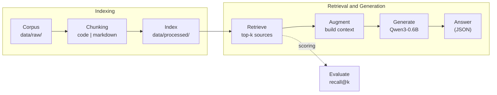

*This project has been created as part of the 42 curriculum by <login1>[, <login2>[, <login3>]].*
 
# RAG Against the Machine
 
A Retrieval-Augmented Generation (RAG) system that answers questions about the vLLM codebase, with grounded answers and measurable retrieval quality.
 
## Table of Contents
 
- [Description](#description)
- [Instructions](#instructions)
- [Example Usage](#example-usage)
- [System Architecture](#system-architecture)
- [Chunking Strategy](#chunking-strategy)
- [Retrieval Method](#retrieval-method)
- [Performance Analysis](#performance-analysis)
- [Design Decisions](#design-decisions)
- [Challenges Faced](#challenges-faced)
- [Resources](#resources)
## Description
 
### Goal
 
Large language models only know what they were trained on. This project addresses that limitation by giving a small local model access to an external knowledge source at answer time, instead of retraining it. The knowledge source is the vLLM repository (documentation and source code), and the model is `Qwen/Qwen3-0.6B`.
 
### Overview
 
The system implements the four classic stages of RAG:
 
1. **Indexing**: the corpus is read, split into chunks and persisted as a searchable index.
2. **Retrieval**: a question is matched against the index and the top-k most relevant source locations are returned (file path and character range).
3. **Augmentation**: the retrieved snippets are filtered and placed in the model's context window within its token budget.
4. **Generation**: `Qwen/Qwen3-0.6B` produces a structured answer grounded in the retrieved context.
Retrieval quality is measured with **recall@k**. The project targets at least 80% recall@5 on documentation questions and 50% on code questions, indexing in under 5 minutes, and answering 200 questions in under 90 seconds.
 
The system is exposed through a command-line interface built with Python Fire. All data exchanged between stages is validated with Pydantic models.
 
## Instructions
 
### Requirements
 
- Python 3.10 or later
- [uv](https://docs.astral.sh/uv/) as project and package manager
- Several gigabytes of free disk space (deep-learning dependencies and model weights)
### Installation
 
```bash
git clone <repository_url>
cd <repository_name>
make install        # runs `uv sync`
```
 
The vLLM corpus must be placed under `data/raw/` and the question datasets under `data/datasets/`, as described in the project layout below.
 
### Makefile Rules
 
| Rule          | Description                                                                 |
|---------------|-----------------------------------------------------------------------------|
| `install`     | Install project dependencies with uv                                        |
| `run`         | Run the main script                                                         |
| `debug`       | Run the main script under Python's built-in debugger (`pdb`)                |
| `clean`       | Remove temporary files and caches (`__pycache__`, `.mypy_cache`, ...)       |
| `lint`        | Run `flake8` and `mypy` with the required flags                             |
| `lint-strict` | Run `flake8` and `mypy --strict` (optional)                                 |
 
### Project Layout
 
```
.
├── src/                    # Python module, run with `python -m src <command>`
├── data/
│   ├── raw/                # Indexed sources (vLLM repository)
│   ├── processed/          # Index produced by the `index` command
│   ├── datasets/
│   │   ├── UnansweredQuestions/
│   │   └── AnsweredQuestions/
│   └── output/
│       ├── search_results/<DatasetScope>/
│       └── search_results_and_answer/<DatasetScope>/
├── pyproject.toml
├── uv.lock
├── Makefile
└── README.md
```
 
### Command-Line Interface
 
Every command is invoked as `uv run python -m src <command> [options]`.
 
| Command           | Options                                                                  | Description                                              |
|-------------------|--------------------------------------------------------------------------|----------------------------------------------------------|
| `index`           | `--max_chunk_size <int>` (default `2000`)                                | Ingest `data/raw/` and build the index in `data/processed/` |
| `search`          | `<query> --k <int>`                                                      | Return the top-k sources for a single query              |
| `search_dataset`  | `--dataset_path <path> --k <int> --save_directory <dir>`                 | Search a whole dataset and write a `StudentSearchResults` JSON file |
| `answer`          | `<query> --k <int>`                                                      | Answer a single query using the retrieved context        |
| `answer_dataset`  | `--student_search_results_path <path> --save_directory <dir>`            | Generate answers for a dataset (`StudentSearchResultsAndAnswer` JSON) |
| `evaluate`        | `--student_search_results_path <path> --dataset_path <path>`             | Compute recall@k against a ground-truth dataset          |
 
All input and output paths are configurable and none are hard-coded. Degenerate inputs (empty query, `k=0`, missing files, malformed JSON) are handled gracefully with explicit error messages rather than tracebacks.
 
## Example Usage
 
**1. Index the corpus**
 
```bash
uv run python -m src index --max_chunk_size 2000
```
 
**2. Search a single query**
 
```bash
uv run python -m src search "How to configure the OpenAI server?" --k 5
```
 
**3. Search a whole dataset**
 
```bash
uv run python -m src search_dataset \
  --dataset_path data/datasets/UnansweredQuestions/dataset_docs_public.json \
  --k 10 \
  --save_directory data/output/search_results/UnansweredQuestions
```
 
**4. Evaluate recall@k**
 
```bash
uv run python -m src evaluate \
  --student_search_results_path data/output/search_results/UnansweredQuestions/dataset_docs_public.json \
  --dataset_path data/datasets/AnsweredQuestions/dataset_docs_public.json
```
 
**5. Generate answers**
 
```bash
uv run python -m src answer_dataset \
  --student_search_results_path data/output/search_results/UnansweredQuestions/dataset_docs_public.json \
  --save_directory data/output/search_results_and_answer/UnansweredQuestions
```
 
**6. Answer a single question**
 
```bash
uv run python -m src answer "How do I enable LoRA adapters?" --k 5
```
 
### Output Format
 
Search output follows the `StudentSearchResults` model:
 
```json
{
  "search_results": [
    {
      "question_id": "q1",
      "question": "How to configure OpenAI server?",
      "retrieved_sources": [
        {
          "file_path": "data/raw/vllm-0.10.1/docs/serving/openai_compatible_server.md",
          "first_character_index": 9867,
          "last_character_index": 10100
        }
      ]
    }
  ],
  "k": 10
}
```
 
Answer output follows the `StudentSearchResultsAndAnswer` model, which adds an `answer` field to each result.
 
## System Architecture


The pipeline is organised into the following components:
 
- **Ingestion and chunking**: walks `data/raw/`, selects relevant files and splits each one with the strategy that matches its type (Python or Markdown/text).
- **Indexer**: tokenizes the chunks, builds the [BM25 / TF-IDF] index and persists it, together with chunk metadata (file path and character offsets), under `data/processed/`.
- **Retriever**: loads the index, scores a query against all chunks and returns the top-k `MinimalSource` objects.
- **Context builder**: selects and orders the retrieved snippets and fits them inside the model's token budget.
- **Generator**: prompts `Qwen/Qwen3-0.6B` with the question and the context, and parses the output into a validated answer.
- **Evaluator**: computes recall@k against ground-truth datasets for local iteration.
- **CLI**: a Python Fire entry point that wires the components together and handles errors and progress reporting (`tqdm`).
- **Data models**: Pydantic models (`MinimalSource`, `UnansweredQuestion`, `AnsweredQuestion`, `RagDataset`, `MinimalSearchResults`, `MinimalAnswer`, `StudentSearchResults`, `StudentSearchResultsAndAnswer`) validate every exchange between stages.
## Chunking Strategy
 
Python files and Markdown pages do not break apart in the same way, so two distinct strategies are implemented. In both cases, no chunk exceeds `--max_chunk_size` (default 2000 characters), and each chunk keeps the exact character offsets of the region it covers in the original file.
 
### Python code chunking
 
[tbu]
 
### Markdown / text chunking
 
[tbu]
 
### Rationale
 
[tbu]
 
## Retrieval Method
 
The system uses **[BM25 / TF-IDF]** as its lexical retrieval algorithm.
 
- **Tokenization**: [tbu].
- **Scoring**: [tbu].
- **Ranking**: [tbu].
- **Post-processing**: [tbu]

## Performance Analysis
 
Measured on [tbu].
 
| Metric                      | Target   | Result  |
|-----------------------------|----------|---------|
| Indexing time (full corpus) | ≤ 5 min  | [tbu] |
| Retrieval, 200 questions    | ≤ 90 s   | [tbu] |
| Recall@5, docs questions    | ≥ 80%    | [tbu] |
| Recall@5, code questions    | ≥ 50%    | [tbu] |
 
Recall at other values of k:
 
| Dataset | Recall@1 | Recall@3 | Recall@5 | Recall@10 |
|---------|----------|----------|----------|-----------|
| Docs    | [tbu]  | [tbu]  | [tbu]  | [tbu]   |
| Code    | [tbu]  | [tbu]  | [tbu]  | [tbu]   |
 
### Effect of chunk size
 
| `--max_chunk_size` | Recall@5 (docs) | Recall@5 (code) | Index size | Indexing time |
|--------------------|-----------------|-----------------|------------|---------------|
| [tbu]            | [tbu]         | [tbu]         | [tbu]    | [tbu]       |
 
 
## Design Decisions
 
[tbu]

## Challenges Faced
 
[tbu]
 
## Resources
 
### References
 
- [vLLM documentation](https://docs.vllm.ai/)
- Lewis et al., [*Retrieval-Augmented Generation for Knowledge-Intensive NLP Tasks*](https://arxiv.org/abs/2005.11401), 2020
- Manning, Raghavan and Schütze, [*Introduction to Information Retrieval*](https://nlp.stanford.edu/IR-book/), Cambridge University Press, 2008
- [Qwen3-0.6B model card](https://huggingface.co/Qwen/Qwen3-0.6B)
- [Pydantic documentation](https://docs.pydantic.dev/)
- [Python Fire](https://github.com/google/python-fire)
- [uv documentation](https://docs.astral.sh/uv/)

### Use of AI
 
[tbu]
 